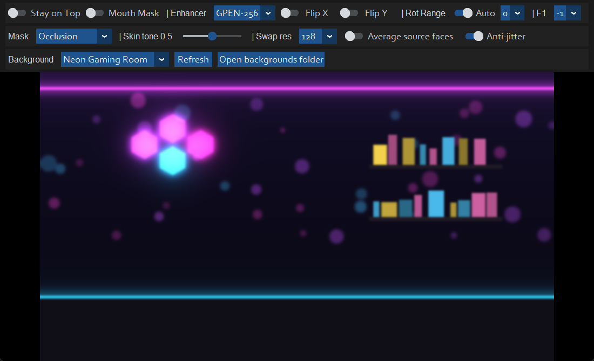
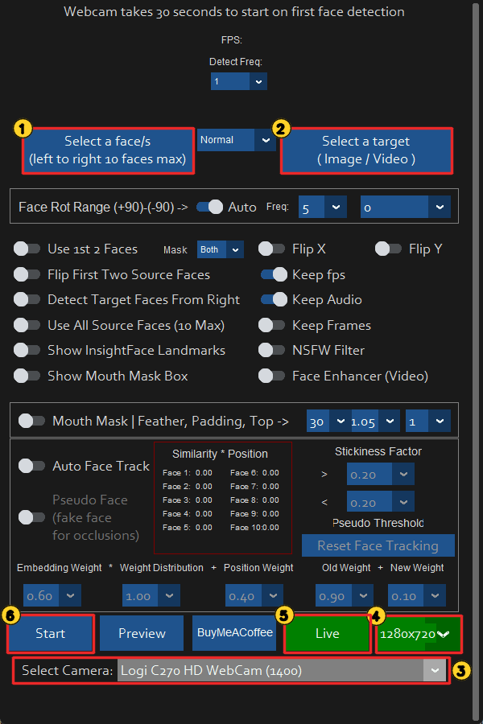
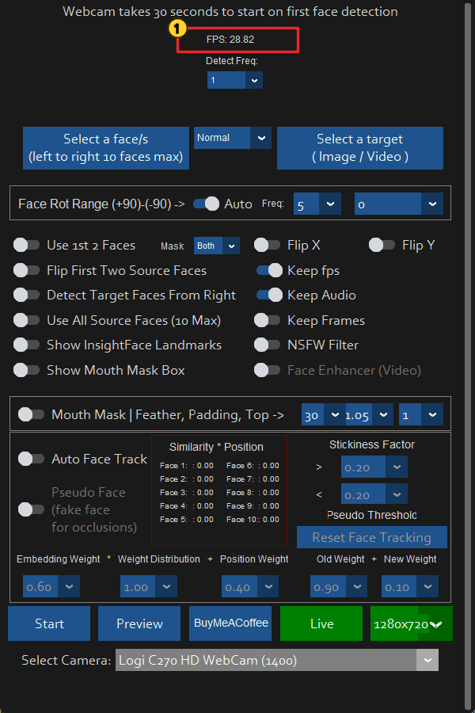
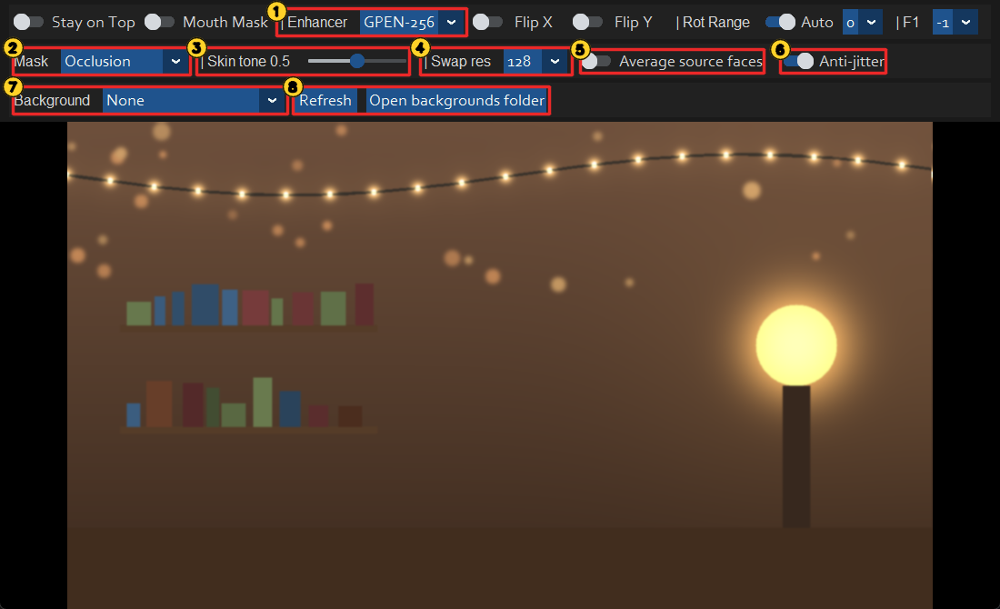
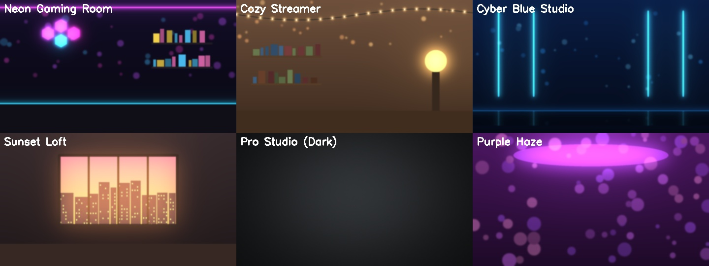
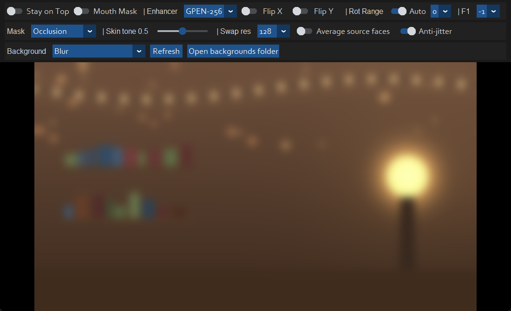

# Streaming Face

Real-time face swap for live streaming: your webcam at **30 FPS in 720p**, with a sharp, realistic
face, hands and hair that stay in front of the face, a steady (non-shimmering) result and a virtual
streaming-room background. It also processes image and video files at the highest quality.

Based on [iRoopDeepFaceCam](https://github.com/iVideoGameBoss/iRoopDeepFaceCam) (itself based on
[roop](https://github.com/s0md3v/roop)), rebuilt for speed and realism on current NVIDIA GPUs
(tested on an RTX 5060 Ti / RTX 50-series).



---

## Contents

1. [What's new compared to iRoopDeepFaceCam](#1-whats-new-compared-to-iroopdeepfacecam)
2. [Requirements](#2-requirements)
3. [Installation, step by step](#3-installation-step-by-step)
4. [First launch](#4-first-launch)
5. [Going live, step by step](#5-going-live-step-by-step)
6. [The live preview toolbar](#6-the-live-preview-toolbar)
7. [Virtual backgrounds](#7-virtual-backgrounds)
8. [Processing image and video files](#8-processing-image-and-video-files)
9. [Using it on a stream (OBS)](#9-using-it-on-a-stream-obs)
10. [Settings reference](#10-settings-reference)
11. [Performance](#11-performance)
12. [How it works](#12-how-it-works)
13. [Troubleshooting](#13-troubleshooting)
14. [Project structure](#14-project-structure)
15. [Credits, licenses and responsible use](#15-credits-licenses-and-responsible-use)

---

## 1. What's new compared to iRoopDeepFaceCam

| Area | Change |
|---|---|
| **Face quality** | The bundled `inswapper_128_fp16.onnx` is a broken conversion (smeared face, dead eyes on every GPU and even on the CPU). The app now uses the original fp32 `inswapper_128.onnx`. |
| **Speed** | Every model runs through **TensorRT**. The swapper uses a custom mixed-precision engine (FP16 convolutions, FP32 normalisation) because plain FP16 breaks it: same image as FP32 at about 10 ms. |
| **Sharpness** | **GPEN** face restoration after the swap (GPEN-256 live, GPEN-512 for files) restores skin, eye and teeth detail. Bicubic paste-back and a light unsharp mask instead of a blurry bilinear paste. |
| **Occlusion** | **XSeg occlusion mask**: hands, hair, cups, glasses and microphones stay in front of the face instead of being painted over. Optional **BiSeNet face-parser** mask follows the real face outline. |
| **Realism** | **Skin-tone matching** to the person's neck/ears and lighting, **camera grain matching**, **pixel boost** (256/512 px swaps), **anti-jitter** landmark smoothing, **averaging several source photos** into one identity. |
| **Virtual background** | **Robust Video Matting** cuts you out of the frame; pick **Blur**, six built-in **streaming rooms** or **your own pictures**. |
| **Live pipeline** | Four stages on their own threads (detect, swap, restore, background) plus a separate camera reader, so the GPU, CPU and display work at the same time. |
| **Stability** | Live can be started and stopped repeatedly; the webcam is always released; TensorRT engines are built in a child process so a TensorRT crash cannot take the app down. |
| **Install** | Working `requirements.txt` for current NVIDIA GPUs (CUDA 12.8), `setup_windows.bat`, automatic model downloads. |

---

## 2. Requirements

| | Minimum | Tested |
|---|---|---|
| OS | Windows 10/11 64-bit | Windows 11 Pro |
| GPU | NVIDIA with a current driver (RTX 20-series or newer recommended) | RTX 5060 Ti 16 GB |
| Python | **3.11** (64-bit) | 3.11.9 |
| Disk | ~10 GB (packages ~6 GB, models ~1.5 GB, TensorRT cache ~2 GB) | |
| Webcam | any USB webcam; 720p at 30 FPS recommended | Logitech C270 |
| ffmpeg | only for video files | ffmpeg 9 |

> RTX 50-series (Blackwell) cards need CUDA 12.8 or newer. The original project's installer uses
> CUDA 11.8 and does **not** work on them; use the steps below.

---

## 3. Installation, step by step

### Step 1: Install Python 3.11

1. Download **Python 3.11 (64-bit)** from <https://www.python.org/downloads/windows/>.
2. In the installer, tick **"Add python.exe to PATH"** and keep **"py launcher"** selected.
3. Check it in a new terminal:
   ```powershell
   py -3.11 --version
   ```

### Step 2: Install Git and ffmpeg

```powershell
winget install Git.Git
winget install Gyan.FFmpeg      # only needed for video files
```

### Step 3: Download the project

```powershell
git clone https://github.com/Roy-Mutwiri/Streaming_Face.git
cd Streaming_Face
```

### Step 4: Create the environment and install packages

Double-click **`setup_windows.bat`**, or run the same commands yourself:

```powershell
py -3.11 -m venv venv
venv\Scripts\python -m pip install --upgrade pip
venv\Scripts\python -m pip install -r requirements.txt
```

This downloads several GB (PyTorch with CUDA 12.8, onnxruntime-gpu, TensorRT, ...).

> **Low on space on C:?** pip caches downloads on C: by default. To keep them elsewhere, set
> `PIP_CACHE_DIR` first, for example: `$env:PIP_CACHE_DIR = "D:\pip-cache"`.

### Step 5: Models (automatic)

You do not need to download models by hand. On the first start the app downloads into `models/`:

| File | Used for | Size |
|---|---|---|
| `inswapper_128.onnx` | face swap (fp32 original) | 530 MB |
| `gpen_bfr_256.onnx`, `gpen_bfr_512.onnx` | face restoration | 75 + 285 MB |
| `xseg_1.onnx` | occlusion mask | 68 MB |
| `bisenet_resnet_34.onnx` | face-parser mask | 90 MB |
| `rvm_mobilenetv3_fp32.onnx` | person matting (virtual background) | 15 MB |
| `GFPGANv1.4.pth` | legacy *Face Enhancer (Video)* switch, downloaded when first used | 330 MB |

InsightFace's face detector/recogniser (`buffalo_l`) is downloaded to `%USERPROFILE%\.insightface`
automatically.

---

## 4. First launch

Double-click **`run-cuda.bat`**, or:

```powershell
venv\Scripts\python run.py --execution-provider cuda --execution-threads 5
```

**The very first launch takes several minutes.** TensorRT builds an optimised engine for every
model on your GPU and saves it in `models/trt_cache/`, and the terminal shows lines such as
`[TRT] Building engine for inswapper_128.onnx (one time, a few minutes)...`. Later launches load the
saved engines in seconds. A new GPU driver or a new TensorRT version triggers one more rebuild.

When it is ready, the main window opens:



---

## 5. Going live, step by step

Follow the numbers in the screenshot above.

1. **Select a face/s**: choose the **source photo**, the face you want to wear.
   - Use a **sharp, front-facing photo**, the face at least ~300 px wide, evenly lit, eyes open,
     nothing covering the face. The source photo decides the quality of every frame.
   - Several faces in one image are read left to right (up to 10) for multi-person swaps, or merged
     into one identity with **Average source faces** (section 6, control 5).
2. **Select a target**: only for files (section 8). Leave it empty for live.
3. **Select Camera**: choose your webcam (or the OBS Virtual Camera, see section 9).
4. **Resolution**: keep **1280x720** (default). More pixels on the face means more real detail.
   Lower it only if your camera cannot deliver 30 FPS at 720p.
5. **Live**: starts the live preview window (a few seconds the first time).
6. **Start** is for processing image/video files (section 8).

While Live runs, the main window shows the frame rate at the top (marker 1):



**Tips for the most realistic result**

- Sit **close** to the camera, the face filling a good part of the frame, facing it, with soft,
  even light (a window or lamp in front of you, not behind you).
- Very side-on poses (profile) are the swap model's weak spot.
- To stop Live, close the preview window. You can start it again any time.

---

## 6. The live preview toolbar

All settings take effect immediately, while you are live.



| # | Control | What it does | Recommended |
|---|---|---|---|
| 1 | **Enhancer** | Face restoration after the swap. **GPEN-256** = sharp eyes/skin at full speed. **GPEN-512** = most natural detail, ~18 FPS. **Off** = raw swap. | GPEN-256 |
| 2 | **Mask** | Which part of the face is replaced. **Occlusion** keeps hands, hair and objects in front of the face. **Parser** follows the exact face outline (no spill onto hair/ears). **Occlusion+Parser** does both (~15 ms slower). **Landmarks** = the original outline method. | Occlusion |
| 3 | **Skin tone** | 0 = keep the source photo's skin colour, 1 = fully match the target's skin and lighting (neck, ears). | 0.5 |
| 4 | **Swap res** | 128 = live speed. 256/512 = *pixel boost*: the face is swapped in 4 or 16 passes for more real detail, too slow for live (files use 256 automatically). | 128 |
| 5 | **Average source faces** | Treat all faces in the source image as photos of the same person and merge them into one steadier likeness. Put 3-5 photos of one person (different angles) side by side in one image. | Off |
| 6 | **Anti-jitter** | Smooths the tiny frame-to-frame movement of the face landmarks, so the face does not shimmer. | On |
| 7 | **Background** | Virtual background (section 7). | None |
| 8 | **Refresh / Open backgrounds folder** | Opens the folder for your own background pictures and re-reads it. | |

The **first toolbar row** keeps the original iRoopDeepFaceCam controls: *Stay on Top*,
*Mouth Mask* (keeps your real mouth, e.g. while eating or drinking), *Flip X/Y*, *Rot Range*
(rotation, with *Auto*), *F1/F2* (which source face to use, -1 = automatic) and *Forehead* (how
much forehead is swapped with the Landmarks mask). The window can be widened to see the whole row.
Double-click the preview to hide or show the toolbars.

---

## 7. Virtual backgrounds

Pick a background in the **Background** dropdown (marker 7 above). The person is cut out with
Robust Video Matting, a model made for live video: hair edges stay soft and the cut-out does not
flicker. Background light softly wraps around your outline and tints you slightly, so you sit in
the room instead of looking pasted on.

| Option | Result |
|---|---|
| **None** | Your real room, untouched. |
| **Blur** / **Blur Strong** | Your real room, out of focus like a wide-aperture camera. |
| **Built-in rooms** | Six generated streaming rooms (below). |
| **Your own pictures** | Any `.jpg/.png/.webp/.bmp` in the `backgrounds/` folder. |

Built-in streaming rooms:



Blur (your real room, defocused):



**Adding your own backgrounds**

1. Click **Open backgrounds folder** (marker 8). The `backgrounds/` folder opens.
2. Copy pictures into it. Any size works; they are scaled and centre-cropped. 16:9 pictures
   (1920x1080, 1280x720) fit best. A photo of a real room that is slightly out of focus looks
   the most realistic.
3. Click **Refresh** and choose the picture in the dropdown.

The cut-out works best when you sit upright and face the camera. A dark chair or clothing that
blends with the person can confuse it at the edges.

---

## 8. Processing image and video files

1. **Select a face/s**: the source photo.
2. **Select a target**: an image (`.jpg/.png`) or a video (`.mp4`, ...).
3. Optional switches in the main window: *Keep fps*, *Keep Audio*, *Use All Source Faces (10 Max)*, *Mouth Mask*.
4. Click **Start** and choose where to save the result.

Files are not real-time, so they automatically use the highest-quality settings: a **256 px
pixel-boost swap**, **GPEN-512** restoration and the selected mask. A 1080p video runs at about
4-5 frames per second on an RTX 5060 Ti.

Command line (no window):

```powershell
venv\Scripts\python run.py --execution-provider cuda -s source.jpg -t input.mp4 -o output.mp4
```

---

## 9. Using it on a stream (OBS)

1. In **OBS**, add a **Window Capture** source and select the live preview window
   (*"Double Click hide Toolbar..."*).
2. **Double-click** the preview to hide the toolbars, so only the picture is captured.
3. Optional: in OBS, **Start Virtual Camera** to use the result in Zoom, Discord, a browser, etc.

To swap an OBS scene or a video instead of your webcam, start the OBS Virtual Camera and choose
it under **Select Camera** in the main window.

---

## 10. Settings reference

Defaults live in `modules/globals.py`; most can be changed in the UI while live.

| Setting | Default | Meaning |
|---|---|---|
| `live_enhancer` | `GPEN-256` | Restorer in Live: `Off`, `GPEN-256`, `GPEN-512` |
| `enhancer_blend` | `0.8` | How much of the restored face is blended over the raw swap |
| `face_mask_mode` | `Occlusion` | `Landmarks`, `Occlusion`, `Parser`, `Occlusion+Parser` |
| `tone_match` | `0.5` | Skin-tone match strength (0..1) |
| `swap_resolution` | `128` | Live swap resolution (128/256/512) |
| `file_swap_resolution` | `256` | Swap resolution for files |
| `file_enhancer` | `GPEN-512` | Restorer for files |
| `temporal_smoothing` | `True` | Anti-jitter in Live |
| `grain_match` | `True` | Put the camera's noise back on the restored face |
| `average_source_faces` | `False` | Merge all source faces into one identity |
| `live_background` | `None` | Virtual background name |
| `matting_interval` | `2` | Refresh the background cut-out every N frames (1 = every frame) |
| `swap_sharpen` | `0.3` | Unsharp mask on the upscaled swap |
| `use_tensorrt` | `True` | TensorRT on; `--no-tensorrt` on the command line turns it off |

Command-line options (`venv\Scripts\python run.py --help` lists all of them):

| Option | Meaning |
|---|---|
| `--execution-provider cuda` | Use the NVIDIA GPU (required for real-time) |
| `--execution-threads 5` | Threads for file processing |
| `--no-tensorrt` | Plain CUDA instead of TensorRT (slower, no engine build) |
| `-s`, `-t`, `-o` | Source, target and output for headless file processing |

---

## 11. Performance

Measured on an RTX 5060 Ti, 1280x720 webcam, one face, all live features on
(GPEN-256, Occlusion mask, skin tone 0.5, anti-jitter, grain match):

| Mode | Live FPS |
|---|---|
| Face swap, no background | **30** (camera limit; the pipeline itself reaches ~31-36) |
| Face swap + built-in room or Blur | **28-30** |
| Before this project's changes | 12 FPS, and a blurry/smeared face |

Per frame, the models take about 3.5 ms (detection) + 2 ms (landmarks) + 10 ms (swap) + 5.5 ms
(occlusion mask) + 6.5 ms (GPEN-256) + 6 ms (background cut-out, every other frame).

`bench_fps.py` measures the live pipeline without a window:

```powershell
venv\Scripts\python bench_fps.py --source source.jpg --target frame.jpg --width 1280 --height 720 --background "Neon Gaming Room"
```

---

## 12. How it works

```mermaid
flowchart LR
    CAM[Camera reader thread<br/>always the newest frame] --> D
    subgraph Live pipeline, one thread per stage
    D[1 Detect<br/>faces + landmarks<br/>anti-jitter<br/>person cut-out in parallel] --> S[2 Swap<br/>inswapper fp32 via TensorRT<br/>occlusion / parser mask in parallel<br/>skin tone, paste-back]
    S --> R[3 Restore<br/>GPEN-256<br/>grain match]
    R --> B[4 Background<br/>blur / room / picture<br/>light wrap]
    end
    B --> UI[Preview window]
```

While frame N is detected, frame N-1 is swapped, N-2 restored and N-3 composited, so the GPU and
CPU work in parallel. This costs about three frames (~100 ms) of delay.

Why some models avoid FP16:

- **inswapper**: its instance-norm layers square values up to ~1500, so the variance reaches
  millions and overflows FP16 (max 65 504). The result is a smeared, blocky face, which is exactly
  what the old `inswapper_128_fp16.onnx` produces. `modules/trt_engine.py` builds a TensorRT engine
  with FP16 convolutions and FP32 statistics: the FP32 image at FP16 speed.
- **GPEN**: FP16 washes out the skin texture, so it runs in TF32 (which is even faster for GPEN-256).
- **XSeg**: its transposed convolutions use asymmetric padding that onnxruntime's CUDA provider runs
  on the CPU; `modules/model_fixes.py` rewrites them into an equivalent GPU-friendly form.

---

## 13. Troubleshooting

| Problem | Fix |
|---|---|
| **The first start takes minutes** | Normal: TensorRT is building engines (see section 4). Only once. |
| **"Camera is not delivering frames"** | Another program is using the webcam: close OBS, Zoom, browser tabs, Discord video or a second copy of this app, then press Live again. Or choose another camera. |
| **"No face found in the source photo"** | The source photo has no detectable face. Use a clearer, front-facing photo and press Live again. |
| **Low FPS** | Use GPEN-256 (not 512), Swap res 128 and the Occlusion mask (not Occlusion+Parser). Close other GPU-heavy programs. The FPS counter cannot exceed your camera's frame rate (usually 30). |
| **Face looks soft** | Use a sharper source photo, sit closer to the camera, keep the Enhancer on GPEN-256. |
| **Face shows a "mask" edge** | Raise *Skin tone*, use the Occlusion or Parser mask, make sure the light falls evenly on your face. |
| **`[TRT] Engine build failed ... using onnxruntime instead`** | The app keeps working on plain CUDA (slower). Update the NVIDIA driver; delete `models/trt_cache` to retry. |
| **Out of disk space on C: during install** | Set `PIP_CACHE_DIR` and `TEMP` to another drive before `pip install` (section 3, step 4). |
| **Video processing fails** | Install ffmpeg (`winget install Gyan.FFmpeg`) and restart the terminal. |

---

## 14. Project structure

```
run.py                       entry point
run-cuda.bat                 start on the NVIDIA GPU
setup_windows.bat            one-time install
bench_fps.py                 live-pipeline benchmark without a window
requirements.txt             working package versions (CUDA 12.8)
modules/
  ui.py                      windows, live pipeline (camera thread + 4 stages)
  core.py                    command line, file processing
  globals.py                 all settings
  face_analyser.py           detection, landmarks, source-face averaging
  processors/frame/
    face_swapper.py          swap, masks, pixel boost, paste-back
    face_enhancer.py         legacy GFPGAN enhancer for files
  accel.py                   TensorRT provider settings
  trt_engine.py              mixed-precision TensorRT engines (built in a child process)
  model_fixes.py             GPU-friendly rewrite of XSeg
  face_restore.py            GPEN restoration, grain
  face_masks.py              occlusion / parser masks, skin-tone matching, noise estimate
  temporal.py                One-Euro landmark smoothing (anti-jitter)
  background.py              person matting, streaming rooms, compositing
backgrounds/                 your own background pictures
models/                      downloaded models and TensorRT cache (not in git)
docs/screenshots/            images used in this README
README_ORIGINAL.md           the original iRoopDeepFaceCam documentation
```

---

## 15. Credits, licenses and responsible use

- Based on **iRoopDeepFaceCam** by iVideoGameBoss and **roop** by s0md3v
  ([README_ORIGINAL.md](README_ORIGINAL.md)). This project keeps their **AGPL-3.0** license
  ([LICENSE](LICENSE)).
- Models: **InsightFace** (`buffalo_l`, `inswapper_128`), **GPEN** (Yang et al.),
  **XSeg** (DeepFaceLab), **BiSeNet** face parsing, **Robust Video Matting** (Lin et al.),
  **GFPGAN** (Tencent ARC). Model files are downloaded from the
  [FaceFusion assets](https://github.com/facefusion/facefusion-assets) and the original projects'
  releases. **Several of these models are licensed for non-commercial research use only. Check
  each model's license before any commercial use.**

**Use this responsibly.** Only use a person's face with their consent. Do not use it to deceive,
impersonate, harass or defraud anyone, and label altered content as such where required. You are
responsible for complying with the laws that apply to you.
